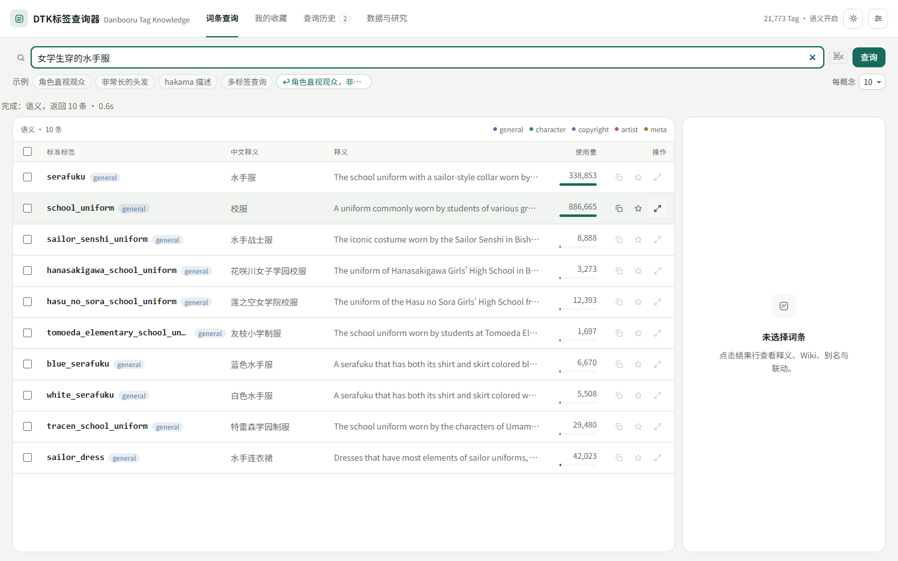
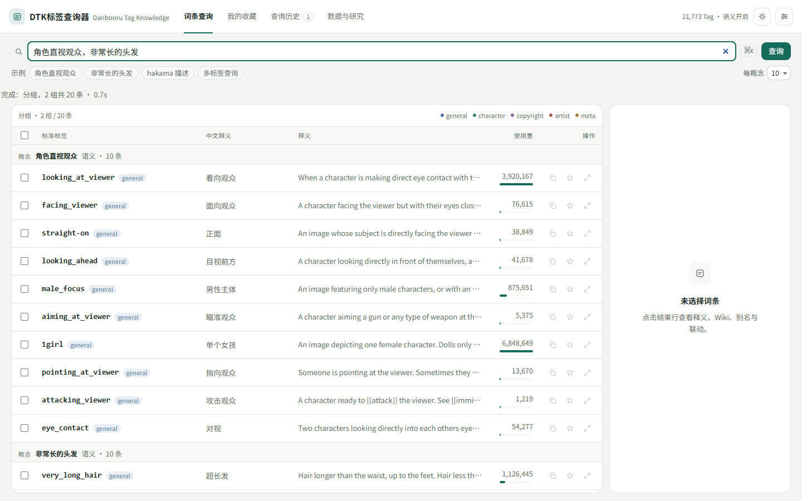
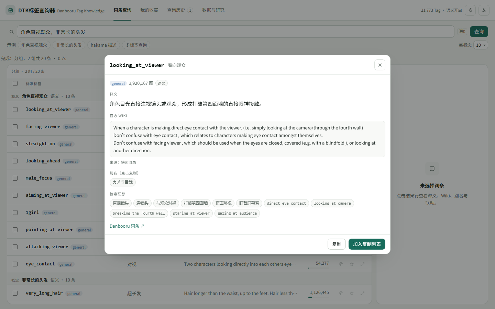

# DTK · Danbooru Tag Knowledge

以 Danbooru Tag 实体为中心的**离线知识库与检索服务**：用中文自然语言描述画面，直接得到规范的 Canonical Tag。

离线运行、数据可追溯、Agent 可通过 MCP / REST 接入。

| 用中文描述画面 | 得到 Canonical Tag |
|---|---|
| 女学生穿的水手服 | `serafuku` |
| 角色直视观众，非常长的头发 | `looking_at_viewer` + `very_long_hair` |

## 界面

**自然语言检索**：不记得英文标签名也能查——中文描述直接命中规范 Tag，附中文释义与使用量。



**多概念分组**：用逗号、顿号或分号分隔的多个概念自动拆分，各自独立检索、分组返回。



**词条详情**：中文释义、官方 Wiki、别名、检索联想与官方 Implication 关系。



## 特性

- **混合检索**：精确名 → Alias（含歧义多候选）→ FTS5 + 向量 RRF 融合，叠加图量对数先验；精确名与 Alias 优先级不受语义影响。
- **跨语言语义**：Qwen3 Embedding 向量索引覆盖图量 ≥100 的 21,773 个 General/Meta Tag；中文、日文、英文描述均可命中。
- **多概念分组**：按明确分隔符拆分子概念，分组返回，不做无标记的语言猜测。
- **知识分层**：官方 Wiki、社区中文译名（ffdkj，MIT，约 33 万条）、LLM 增强层（中文定义 / 检索联想）分层合并；研究产出默认不进索引，须人工审核发布。
- **多端接口**：CLI、本地 Web UI、桌面窗口（pywebview）、只读 MCP（stdio）与 REST。
- **数据安全**：Source Snapshot 只读；Derived Store 可随时删除重建；Agent 接口只读，不会触发研究或写入。

## 安装

Python 3.10+，唯一硬依赖 NumPy。

```powershell
git clone https://github.com/chenxluo/dtk.git
cd dtk
pip install .            # 桌面窗口: pip install .[gui]

python -m dtk bootstrap  # 首次运行：从 GitHub Releases 下载派生库与向量索引（约 255 MB）
python -m dtk serve      # 打开 http://127.0.0.1:8765
```

语义检索需要一个 OpenAI 兼容的本地 Embedding 服务，加载 **Qwen3-Embedding-4B**（如 LM Studio，默认 `http://127.0.0.1:6001/v1`；可用 `DTK_LLM_BASE_URL` 覆盖）。Embedding 服务不可用时自动降级为 FTS，界面明确提示。向量索引与 Embedding 模型绑定，换模型需用 `dtk embed` 重建。

已有 Danbooru 官方数据库快照的用户可以从源库自建：`DTK_SOURCE_DB=<快照路径> python -m dtk import && python -m dtk embed`。导入只读源库，行数对账，不回写。

## 快速开始

```powershell
python -m dtk search "Looking At Viewer"                 # 英文精确名 / FTS
python -m dtk search "角色直视观众，非常长的头发" --limit 5  # 中文多概念分组
python -m dtk search "角色直视观众" --no-vectors          # 只用精确名 + Alias + FTS
python -m dtk get looking_at_viewer                      # 完整词条：Wiki、别名、关系
python -m dtk related black_footwear --min-count 100     # 本地共现关系（Lift 排序）
python -m dtk info                                       # 快照与导入清单
```

CLI 全部命令见 `python -m dtk --help`，按查询 / 建库 / 官方同步 / 研究 / 发布分组。

## Agent 接入

MCP（stdio），工具为只读的 `search_tags` 与 `get_tags`：

```json
{
  "mcpServers": {
    "dtk": {
      "command": "python",
      "args": ["-m", "dtk", "mcp", "--db", "data/dtk.db"]
    }
  }
}
```

或本地 REST（`python -m dtk serve`）：`GET /api/search?query=...`、`GET /api/tag?name=...`、`GET /health`。

输出为结构化状态（`ok` / `no_match` / `ambiguous` / `low_confidence`），Alias 歧义返回全部候选。详见 [docs/AGENT.md](docs/AGENT.md)。

## 数据与评测

当前派生库规模（快照：最新帖子 2026-08-23）：

| 数据 | 数量 |
|---|---:|
| Canonical Tag | 1,082,991 |
| Wiki（快照 + 官方补缺） | 335,769 + 7,378 |
| Alias（其中歧义） | 616,836（6,308） |
| 中文译名（ffdkj） | 329,760 |
| 官方 Tag Implication | 47,069 |
| 语义向量索引 | 21,773 Tag |

50 条人工基准（`eval/benchmark.jsonl`，含 3 个无意义负例）：

| 检索配置 | MRR | hit@5 | hit@10 | 无意义拦截 |
|---|---:|---:|---:|---:|
| 仅 FTS（M1） | 0.589 | 0.609 | 0.652 | — |
| FTS + 向量 RRF（M2） | 0.763 | 0.848 | 0.870 | — |
| + 补缺 Wiki / 译名 / 增强层（当前） | 0.872 | 0.915 | 0.979 | 1.0 |

复跑：`python -m dtk eval eval/benchmark.jsonl --k 1,5,10`。

## 架构

```mermaid
  A["Source Snapshot<br/>只读官方库"] -->|import 只读对账| B["Derived Store<br/>dtk.db + FTS5"]
  B --> C["检索层<br/>Exact / Alias / FTS / Vector RRF"]
  E["官方同步<br/>implication / wiki / 译名"] --> B
  F["Research Agent<br/>证据可定位"] -->|人工审核发布| B
  C --> G["CLI / Web UI / MCP / REST"]
```

核心约定：Source Snapshot 不可变；Derived Store 确定性可重建；Research Candidate 默认不进检索索引，人工显式发布后经独立向量索引以高阈值（余弦 ≥0.65）参与召回。决策记录见 [docs/adr/](docs/adr/)。

## 研究管线

对缺 Wiki 的高用量 Tag，Research Agent 用 LLM + 网络搜索产出带原文引用的候选知识，落盘 `out/research/*.jsonl`；机械复核（`audit-research`）与人工审核通过后显式发布（`publish-research`），不改官方 Wiki，且发布前后跑基准对照，要求目标查询改善且无整体回归。

```powershell
python -m dtk research --types general --limit 10 --dry-run
python -m dtk audit-research out/research/pilot_general.jsonl
python -m dtk publish-research out/research/pilot_general.jsonl --tags black_footwear,white_footwear
```

## 文档

- [docs/PLAN.md](docs/PLAN.md) — 施工计划与当前状态
- [docs/STANDARDS.md](docs/STANDARDS.md) — 施工规范
- [CONTEXT.md](CONTEXT.md) — 领域语言
- [docs/adr/](docs/adr/) — 架构决策记录
- [docs/RESEARCH-LOG.md](docs/RESEARCH-LOG.md) — 研究试点记录
- [docs/AGENT.md](docs/AGENT.md) — Agent 接入

## 开发

```powershell
python -m unittest discover -s tests -v
```

## 数据来源

- Tag / Wiki / Alias / Implication：Danbooru 官方数据库快照与公开 API，仅元数据，不含图片。
- 中文译名：[ffdkj-Danbooru_Tag-Chinese-English-Translation-Table](https://github.com/ffdkj/ffdkj-Danbooru_Tag-Chinese-English-Translation-Table)（MIT）。
- 语义向量：Qwen3-Embedding-4B 本地生成。
